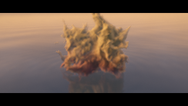
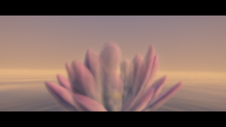

# Metamorphosis Volume

CUDA port of [Metamorphosis Volume by dathor](https://www.shadertoy.com/view/NXySRV),
based on [Volumetric Perlin to exact SDF by FabriceNeyret2](https://www.shadertoy.com/view/NXGSRK).
The ellipsoid distance approximation is by Inigo Quilez. Refer to the original
authors for licensing terms; the repository's license does not grant additional
rights to their shader.

From the `jetson` directory on an original Jetson Nano with CUDA and X11 headers:

```bash
make cuda_metamorphosis
./cuda_metamorphosis
```

The default render resolution is 480 x 270. This is an expensive volumetric demo:
it integrates both the object and its water reflection and performs a separate
post-processing pass. Nano performance has not been measured. For less work:

```bash
./cuda_metamorphosis --width 320 --height 180 --no-post
```

Keys: **Q/Escape** quit, **Space** pause/resume, **R** restart time, **P** toggle
post-processing. `--time 18` starts at a particular point in the animation.
The morph and camera keyframes follow the original 40-second sequence.

Sample CUDA renders (320 x 180):




To render without an X11 display:

```bash
./cuda_metamorphosis --time 18 --output lotus.ppm
```

The port implements all three original passes: Volume A, Buffer A and Image.
It includes the Perlin cloud/lotus morph, animated camera, translucent shading,
water waves and reflections, depth of field, bloom, atmospheric haze, sun rays,
film grading and letterboxing. `--no-post` skips the expensive spatial effects
but retains tone mapping and grading.

The two time-independent shape fields are baked once into GPU memory at startup.
Each frame blends them and propagates the outer distance field through the
original 26-neighbor rule. A linearly filtered, clamped CUDA 3D texture supplies
the volume sampler; an HDR framebuffer with depth in alpha supplies the Image
pass, using nearest/clamped sampling as configured in Shadertoy.
The distance field warms up for 128 iterations before the first rendered frame.
Startup can take a while on a Nano. About 40 MiB of GPU storage is used at the
default resolution, excluding CUDA runtime overhead.

The original Volume A pass writes a cached value when no update is needed, but
then continues into its field computation. This port caches the static shape
calculations explicitly and still propagates once per displayed frame. The
outer field can therefore differ during rapid morphs or at low frame rates;
the shape formulas and shading are retained. GPU floating-point differences can
also change the fine procedural noise.

For local kernel validation on Windows, the same file supports headless output:

```powershell
nvcc -std=c++11 -O3 -arch=sm_86 -allow-unsupported-compiler -o cuda_metamorphosis.exe cuda_metamorphosis.cu
.\cuda_metamorphosis.exe --time 18 --output lotus.ppm
```

Use an architecture supported by your local GPU/toolkit. The interactive X11
display is compiled only on Linux; no Windows display dependency is introduced.
