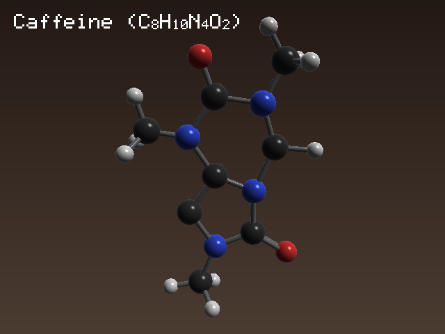

# CUDA Molecule Visualization for Jetson

Port of `windows/cuda_molecule.cu` to Linux/X11. All 233 entries in the Windows
molecule library, including the random molecule generator, are retained, along
with CPK colors, atom sizes, single/double/triple bonds, lighting and name overlays.
The models are the existing visualization presets, not a molecular simulation.



On node3, from the directory containing the Jetson sources:

```bash
make cuda_molecule
./cuda_molecule
```

Requires the CUDA Toolkit supplied with JetPack and X11 development headers
(`libx11-dev`). The Makefile targets the original Nano's `sm_53` GPU and enables
C++11 for the host clock and framebuffer. A direct build is:

```bash
/usr/local/cuda/bin/nvcc -std=c++11 -O3 -arch=sm_53 \
    -o cuda_molecule cuda_molecule.cu -lX11
```

Run in an X11 desktop session or with a configured forwarded X11 display.
The default resolution is 640 x 480; the original Windows resolution is available:

```bash
./cuda_molecule --width 1024 --height 768
```

For less rendering work on larger molecules:

```bash
./cuda_molecule --width 320 --height 240
```

| Key | Action |
| --- | --- |
| A / D | Previous / next molecule, wrapping through the library |
| R | Select a random entry; the final entry generates a random molecule |
| Arrow keys | Rotate view |
| W / S | Zoom in / out |
| Space | Pause / resume automatic rotation |
| Q / Escape | Quit |

Both upper- and lowercase letter keys work. Closing the window also exits.
Auto-rotation advances at 0.6 radians/second, independent of frame rate.

List presets or select one at startup (indices are 1-based):

```bash
./cuda_molecule --list
./cuda_molecule --molecule 5
```

Render without an X11 display, or validate the library without creating a CUDA
context:

```bash
./cuda_molecule --molecule 5 --output caffeine.ppm
./cuda_molecule --check-library
```

The port replaces Win32 windowing, input, timers and `Sleep` with X11, a monotonic
clock and `usleep`. Its molecule atom type is named `MoleculeAtom` to avoid
X11's `Atom` typedef. It checks CUDA failures and validates molecule indices
before upload. The text buffer is allocated once and freed on exit; text is
uploaded only when changing molecules. A blank font spacing column is handled
explicitly to avoid the original negative bit shift.

Validation completed locally with CUDA 12.9 on an RTX 3080: all 233 builders
passed atom/bond validation; caffeine and Random were rendered at 640 x 480 and
321 x 241 respectively; the `sm_53` GPU target also compiled. Jetson CUDA 10.2,
interactive X11 behavior and Nano performance still need device verification.
The same source supports Windows headless builds for GPU render checks; the
existing Windows demo remains separate.
