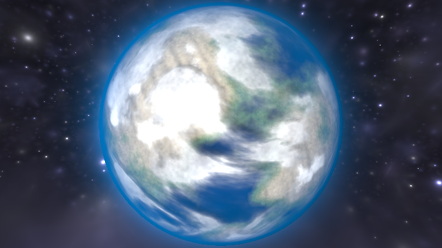

# Not quite home

CUDA port of [Not quite home by xwize](https://www.shadertoy.com/view/Mt33Wj),
based on Inigo Quilez's work (original source notice: iq/2013).

The original shader specifies [Creative Commons Attribution-NonCommercial-ShareAlike
3.0 Unported](https://creativecommons.org/licenses/by-nc-sa/3.0/). This adaptation
retains that license and attribution. The repository's MIT license does not
supersede those terms.



Build and run from the `jetson` directory on node3:

```bash
make cuda_not_quite_home
./cuda_not_quite_home
```

Requires CUDA and `libx11-dev`. The default resolution is 640 x 360. Run in an
X11 desktop session, or with an appropriately configured forwarded X11 display.
For a smaller render:

```bash
./cuda_not_quite_home --width 320 --height 180
```

Keys: **Q/Escape** quit, **Space** pause/resume, **R** restart time.

Render a single frame without a display:

```bash
./cuda_not_quite_home --time 40.17 --output planet.ppm
```

The program is self-contained. It uses the original shader's active
`USE_PROCEDURAL` noise branch, so the unused Shadertoy noise texture is not
required. It preserves the camera orbit, ocean variation, terrain and snow,
cloud shadows, moving clouds, sunlight, atmosphere glow, fractal star field,
and square-root output transfer.

The GLSL column-major noise matrix is translated explicitly. Rays that miss
the planet skip surface noise, which the original computes and then blends
away. Guards protect isolated division singularities, and output is clamped
to the display's 8-bit range. Float precision differences between GLSL and CUDA
can alter small procedural details, particularly in the high-frequency noise.

Validation: compiled and rendered on an RTX 3080 with CUDA 12.9; generated
640 x 360 and 321 x 181 frames, and separately compiled the `sm_53` GPU target.
Compilation with Jetson's CUDA 10.2, its X11 display path, and Nano runtime
performance still need verification on the device.

Windows headless validation (with a configured MSVC/CUDA environment):

```powershell
nvcc -O3 -arch=sm_86 -o cuda_not_quite_home.exe cuda_not_quite_home.cu
.\cuda_not_quite_home.exe --time 40.17 --output planet.ppm
```

Use a GPU architecture matching your Windows GPU. The Linux Makefile supplies
`-std=c++11` for the host clock and framebuffer on CUDA 10.2.
